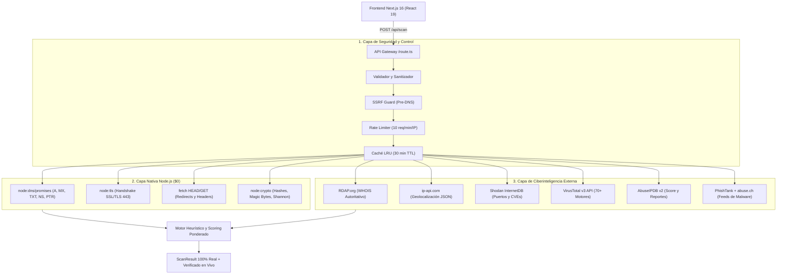

# ThreatScan / SecScanner 0.1 — Plataforma de Análisis de Amenazas en Tiempo Real

Plataforma profesional de **Threat Intelligence** y análisis heurístico/forense para la detección en tiempo real de anomalías, infraestructura maliciosa y compromisos de seguridad en **URLs, Dominios, Direcciones IP, Hashes criptográficos y Archivos/APKs**.

Desarrollada con un stack moderno sobre **Next.js 16 (App Router)** y diseñada con una arquitectura resiliente de **presupuesto cero ($0)** que combina capacidades nativas de Node.js con APIs autoritativas de seguridad de nivel comunitario.


---

## 🎯 Capacidades Principales

### 1. Detección Multidimensional de Amenazas
- **URLs y Dominios**: Typosquatting con distancia Levenshtein contra más de 80 marcas globales y de banca latinoamericana, homoglyphs/IDN Punycode (`xn--`), acortadores de URL, trucos de credenciales en URL (`@`), servidores basados en IP pura, dominios DGA por alta entropía de Shannon, detección de TLDs de alto riesgo y extracción de cargas útiles codificadas en Base64 dentro de los parámetros de consulta.
- **Direcciones IP**: Análisis de reputación global de abusos, geolocalización física y por ASN, detección de nodos de salida Tor/proxies, puertos de red expuestos con correlación de CVEs conocidos y resolución inversa (rDNS/PTR).
- **Hashes (MD5, SHA-1, SHA-256)**: Comprobación pasiva inmediata contra más de 70 motores antivirus y bases de datos globales de muestras de malware.
- **Archivos y APKs de Android**: Análisis binario estático en memoria, validación de Magic Bytes (sin confiar en la extensión), cálculo de entropía de Shannon para detectar empaquetadores/cifrado y extracción automática de permisos de riesgo en manifiestos de aplicaciones móviles (`AndroidManifest.xml`).

### 2. Garantía de Transparencia: En Vivo vs. Demo
Siguiendo los principios de integridad forense:
- **Badge `[✓ Verificado en Vivo]`**: Aparece de forma dinámica cuando los datos provienen de consultas en tiempo real y llamadas autoritativas al backend.
- **Badge `[⚠ Simulado]`**: Se preserva exclusivamente en los registros de demostración iniciales (seed data) para que ningún dato sintético sea confundido con un indicador verificado.
- **Badge por Pestaña Técnica**: Cada pestaña de evidencia (DNS, TLS, RDAP, Cabeceras, Puertos, Reputación) detalla el estado exacto de su fuente (`En Vivo` o `No disponible`).

### 3. Reporte Forense y Exportación
- **Puntuación de Riesgo Ponderada (0 a 100)** y **Grado (A a F)** con veredicto claro (`Malicioso`, `Sospechoso`, `Limpio`).
- **Desglose de Hallazgos** clasificados por severidad (Crítico, Alto, Medio, Bajo, Informativo) con referencias a técnicas MITRE ATT&CK y taxonomía CWE.
- **Exportación Forense JSON**: Descarga en un clic y copiado al portapapeles con metadatos técnicos de trazabilidad (`dataSource`, `verifiedSources`, `engine`, `timestamp`).
- **Historial Local de 10 Análisis** persistido en `localStorage` con filtros por veredicto y tipo de indicador.

---

## 🏗️ Arquitectura del Sistema (6 Fases de Implementación)

El motor fue transformado de un prototipo heurístico simulado a un backend de inteligencia de amenazas de 6 capas:



### Detalle de Módulos Implementados

1. **Fase 0 — Infraestructura y Seguridad Perimetral**:
   - `src/lib/server/validator.ts`: Sanitización de cadenas, control de longitud, filtrado anti-XSS y de caracteres de control.
   - `src/lib/server/ssrf-guard.ts`: Bloqueo estricto de direcciones privadas (RFC 1918), bucle local (`127.0.0.1`), direcciones IPv6 locales y servicios de metadatos en la nube (`169.254.169.254`).
   - `src/lib/server/rate-limiter.ts`: Limitador de tasa en memoria (10 peticiones/minuto por IP) con cabeceras estándar `X-RateLimit-*` y `Retry-After`.
   - `src/lib/server/cache.ts`: Almacenamiento en caché LRU en memoria con tiempo de vida (TTL) de 30 minutos indexado por SHA-256.

2. **Fase 1 — Consultas Nativas Node.js**:
   - `src/lib/services/dns.ts`: Resolución asíncrona de registros A, AAAA, MX, TXT, NS y PTR con validación post-DNS contra ataques de **DNS Rebinding**.
   - `src/lib/services/tls.ts`: Inspección directa del certificado mediante socket TLS en el puerto 443; evalúa emisor, validez temporal, días hasta expiración y dominios SAN.
   - `src/lib/services/headers.ts`: Rastreo de hasta 5 saltos de redirección y comprobación de cabeceras de endurecimiento (`Strict-Transport-Security`, `Content-Security-Policy`, `X-Frame-Options`, `X-Content-Type-Options`).

3. **Fase 2 — WHOIS y Geolocalización**:
   - `src/lib/services/rdap.ts`: Consulta de datos de registro mediante protocolo RDAP oficial en formato JSON estructurado; cálculo de antigüedad del dominio en días y contacto de abuso del registrador.
   - `src/lib/services/geolocation.ts`: Geolocalización por IP mediante `ip-api.com`, extrayendo código de país, ciudad, coordenadas geográficas, ASN, ISP y organización.

4. **Fase 3 — Infraestructura y Reputación**:
   - `src/lib/services/shodan.ts`: Interrogación de puertos abiertos y vulnerabilidades registradas (CVEs) a través de Shodan InternetDB (sin autenticación requerida).
   - `src/lib/services/abuseipdb.ts`: Consulta del índice de confianza de abuso y conteo de reportes en 90 días mediante la API v2 de AbuseIPDB.
   - `src/lib/services/virustotal.ts`: Consulta multiformato a la API v3 de VirusTotal para URLs (codificadas en base64url), dominios, IPs y hashes con desglose de motores de detección.

5. **Fase 4 — Detección de Phishing y Feeds de Amenazas**:
   - `src/lib/services/phishing.ts`: Verificación cruzada con la base de datos de PhishTank y la API v4 de Google Safe Browsing.
   - `src/lib/services/abusech.ts`: Integración con la suite de ciberinteligencia de abuse.ch (URLhaus para URLs maliciosas, ThreatFox para IoCs de botnets y MalwareBazaar para hashes).

6. **Fase 5 — Análisis Estático de Archivos y Heurística Avanzada**:
   - `src/lib/services/file-static.ts`: Análisis de buffers en memoria; extracción de firmas criptográficas (MD5, SHA1, SHA256), cálculo de entropía de Shannon y análisis de permisos en aplicaciones Android APK.
   - `src/lib/services/heuristic.ts`: Algoritmo determinista de distancia Levenshtein contra más de 80 marcas de alta exposición, detección de homoglyphs en Punycode (`xn--`) y decodificación pasiva de cargas útiles Base64 en query strings.

7. **Fase 6 — Verificación en Vivo, Exportación y Despliegue en Producción**:
   - `src/app/api/scan/route.ts`: Orquestación paralela con `Promise.allSettled`, control CORS, logging estructurado JSON y cálculo dinámico de recomendaciones de SOC.
   - `src/components/ThreatReport.tsx`: Badges dinámicos de estado por servicio, botón de exportación forense JSON y vista adaptada para auditoría.
   - `next.config.ts`: Cabeceras de seguridad perimetral HTTP (HSTS, CSP, X-Frame-Options: DENY, X-Content-Type-Options: nosniff, Permissions-Policy).

---

## 🛠️ Variables de Entorno

El proyecto opera bajo un modelo de **degradación elegante**: funciona al 100% incluso sin ninguna clave de API configurada (utilizando los módulos nativos de DNS, TLS, Headers, RDAP, Shodan, Geolocalización, Análisis Estático y Heurística).

Para habilitar las fuentes de reputación avanzadas, configure un archivo `.env.local`:

```bash
# ==============================================================================
# ThreatScan / SecScanner — Variables de Entorno
# ==============================================================================

# --- APIs con Clave Gratuita (Opcionales) ---
# VirusTotal v3 API (500 req/día gratis): https://www.virustotal.com/gui/my-apikey
VIRUSTOTAL_API_KEY=

# AbuseIPDB v2 API (1000 req/día gratis): https://www.abuseipdb.com/account/api
ABUSEIPDB_API_KEY=

# Google Safe Browsing v4 (10,000 req/día gratis en Google Cloud Console)
GOOGLE_SAFEBROWSING_KEY=

# PhishTank API (Opcional, mejora la cuota): https://phishtank.org/
PHISHTANK_APP_KEY=

# abuse.ch Auth Key (Opcional para URLhaus/ThreatFox): https://auth.abuse.ch/
ABUSECH_AUTH_KEY=

# --- Control y Caché ---
RATE_LIMIT_MAX=10           # Peticiones máximas por minuto por IP (default: 10)
CACHE_TTL_MINUTES=30        # Tiempo de vida de la caché en memoria (default: 30)
```

> **Aviso de Seguridad:** El archivo `.env.local` está incluido en `.gitignore` y **nunca** debe ser comprometido en el repositorio. En despliegues de producción (Vercel), configure estas variables desde el panel de configuración del proyecto (*Settings → Environment Variables*).

---

## 🚀 Instalación y Ejecución Local

### Prerrequisitos
- Node.js 18.18+ o Node.js 20+
- npm 9+

### Pasos

1. **Clonar el repositorio**:
   ```bash
   git clone https://github.com/nuveneqra007-rgb/secscanner0.1.git
   cd secscanner0.1
   ```

2. **Instalar dependencias**:
   ```bash
   npm install
   ```

3. **Configurar el entorno**:
   ```bash
   cp .env.example .env.local
   # Editar .env.local y añadir las API keys deseadas
   ```

4. **Ejecutar el servidor de desarrollo**:
   ```bash
   npm run dev
   ```
   Abra [http://localhost:3000](http://localhost:3000) en su navegador.

5. **Validar antes de desplegar**:
   ```bash
   npm run lint   # Validación de ESLint sin errores ni warnings
   npm run build  # Compilación de producción con Next.js
   ```

---

## 📡 Referencia de la API

### Escanear Indicador
`POST /api/scan`

#### Headers
```http
Content-Type: application/json
```

#### Request Body (Ejemplos)

**URL o Dominio:**
```json
{
  "indicator": "https://banc0-santander-login.com/auth"
}
```

**Dirección IP:**
```json
{
  "indicator": "185.220.101.47"
}
```

**Hash:**
```json
{
  "indicator": "e3b0c44298fc1c149afbf4c8996fb92427ae41e4649b934ca495991b7852b855"
}
```

**Archivo o APK:**
```json
{
  "indicator": "sample.apk",
  "fileName": "sample.apk",
  "fileBase64": "UEsDBBQAAAAIA..."
}
```

#### Response Headers
- `X-RateLimit-Limit`: Cuota máxima permitida (10 req/min).
- `X-RateLimit-Remaining`: Peticiones restantes en la ventana actual.
- `X-RateLimit-Reset`: Timestamp UNIX del reinicio de cuota.
- `X-Cache`: `HIT` si provino de la caché en memoria, `MISS` si fue evaluado en vivo.

#### Response Body (Extracto Forense)
```json
{
  "id": "scan_1732134567890_a1b2c3",
  "timestamp": "2026-11-20T19:30:00.000Z",
  "input": "https://banc0-santander-login.com/auth",
  "type": "url",
  "verdict": "malicious",
  "riskScore": 88,
  "grade": "F",
  "confidence": "Alta (DNS, TLS, HTTP, RDAP, VirusTotal y Threat Intel en vivo)",
  "summary": "Este URL presenta indicadores críticos de compromiso...",
  "findings": [
    {
      "id": "heur-typo-santander",
      "severity": "critical",
      "title": "Posible typosquatting de la marca \"santander\"",
      "description": "El dominio simula la marca legítima utilizando sustitución de caracteres (banc0).",
      "mitre": "T1583.001"
    }
  ],
  "evidence": {
    "dns": { "a": ["198.51.100.24"] },
    "ssl": { "issuer": "Let's Encrypt", "daysUntilExpiry": 42 },
    "geolocation": { "country": "Panama", "asn": "AS12345" }
  },
  "isLive": true,
  "dataSource": "live",
  "sources": {
    "dns": "live",
    "tls": "live",
    "rdap": "live",
    "virustotal": "live"
  }
}
```

---

## 🔒 Consideraciones de Seguridad y Privacidad

- **Zero-Storage**: No se almacena ninguna información del usuario en bases de datos del servidor. Los buffers de archivos cargados se procesan exclusivamente en memoria volátil y son descartados inmediatamente tras el cálculo de hashes y entropía.
- **Zero-Upload a APIs Externas**: Cuando un usuario analiza un archivo o APK, el binario **nunca** se sube a plataformas externas. Únicamente se consulta de forma pasiva su firma criptográfica SHA-256.
- **Protección Antirreconexión DNS (DNS Rebinding Guard)**: Las direcciones IP resueltas se validan tras la consulta DNS; si un dominio público resuelve a una IP interna (`192.168.x.x`, `10.x.x.x`, `127.x.x.x`, o metadatos de nube), la conexión se cancela inmediatamente con código HTTP 403.
- **Límite de Procesamiento Binario**: Los archivos tienen un tope máximo estricto de 20 MB para prevenir ataques de denegación de servicio por memoria.

---

## ☁️ Despliegue en Vercel

1. Vincule su repositorio de GitHub en el panel de **Vercel**.
2. Configure el Framework Preset como **Next.js**.
3. En la sección **Environment Variables**, agregue las variables descritas en `.env.example` (`VIRUSTOTAL_API_KEY`, `ABUSEIPDB_API_KEY`, etc.).
4. Haga clic en **Deploy**. La configuración de `next.config.ts` aplica automáticamente las cabeceras HTTP de seguridad requeridas para producción.

---

## 📜 Licencia

Distribuido bajo la licencia MIT. Consulte `LICENSE` para más información.
