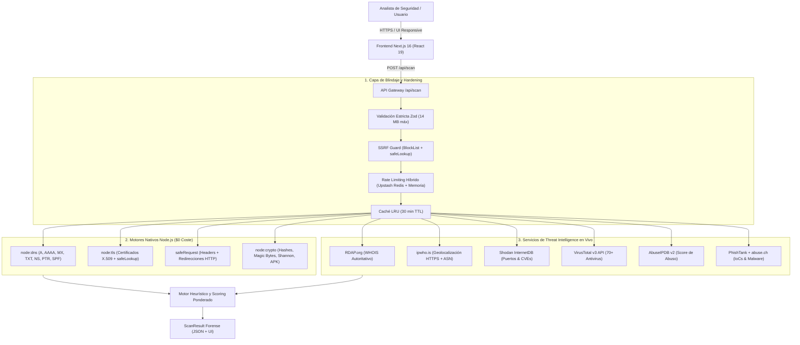

# 🛡️ SecScanner — Threat Intelligence & Cyber Risk Engine

Plataforma profesional de **Threat Intelligence**, análisis heurístico y auditoría forense en tiempo real diseñada para la detección inmediata de anomalías, infraestructura maliciosa y vectores de ataque en **URLs, Dominios, Direcciones IP, Hashes criptográficos y Archivos/APKs**.

SecScanner combina capacidades nativas de **Node.js** con APIs autoritativas de seguridad global bajo un modelo de arquitectura **Local-First**, **Zero-Storage** y **Cero Coste Operativo ($0)**.

[](https://secscanner.dpdns.org)
[](https://nextjs.org/)
[](https://react.dev/)
[](https://www.typescriptlang.org/)
[](https://tailwindcss.com/)
[](https://github.com/nuveneqra007-rgb/secscanner0.1)
[](LICENSE)

🌐 **Instancias en Producción:**
- Dominio Principal: [https://secscanner.dpdns.org/](https://secscanner.dpdns.org/)
- Dominio Vercel: [https://secscanner0-1.vercel.app/](https://secscanner0-1.vercel.app/)

---

## ✨ Lo que Promete y Garantiza SecScanner

1. **Inteligencia de Amenazas 100% Real y Verificada en Vivo**
   - Sin datos simulados ni estimaciones sintéticas en escaneos en vivo.
   - Integración simultánea con más de 8 fuentes autoritativas globales: **VirusTotal v3**, **AbuseIPDB v2**, **Shodan InternetDB**, **ThreatFox**, **MalwareBazaar**, **PhishTank**, **RDAP Whois** y **ipwho.is**.
   - Cada métrica del reporte cuenta con trazabilidad técnica y badge de procedencia (`[✓ Verificado en Vivo]`).

2. **Privacidad Absoluta y Filosofía Zero-Storage**
   - **Tus datos son tuyos:** SecScanner no almacena consultas ni persiste información del usuario en bases de datos del servidor.
   - **Análisis de Archivos Volátil:** Los archivos APK, ZIP, EXE o documentos cargados se procesan en memoria en el runtime serverless y se destruyen inmediatamente tras calcular hashes, entropía de Shannon y extraer manifiestos.
   - **Zero-Upload de Binarios a Terceros:** El contenido binario de tus archivos **nunca se sube a internet ni a servicios externos**; únicamente se consulta de forma pasiva su firma criptográfica SHA-256.
   - **Historial 100% Local:** Tu historial de auditoría vive exclusivamente en el `localStorage` de tu propio navegador.

3. **Veredicto Accionable y Scoring Ponderado (0 a 100)**
   - Algoritmo unificado de puntuación de riesgo con grado escolar (**Grado A a F**) y veredicto inequívoco: **Limpio**, **Sospechoso** o **Malicioso**.
   - Generación automática de **Recomendaciones Tácticas para SOC / CSIRT**: contención perimetral, reglas de firewall, bloqueo RPZ y búsqueda de IoCs en registros de SIEM.

4. **Diseño 100% Adaptable (Mobile a 4K)**
   - Interfaz con estética moderna SOC Dark Cyber construida con CSS Grid, Flexbox elástico y tipografía fluida `clamp()`.
   - Experiencia optimizada tanto en smartphones como en monitores ultra-wide 4K.

---

## 🎯 Capacidades de Análisis por Indicador

### 🌐 URLs y Nombres de Dominio
- **Detección de Typosquatting:** Algoritmo determinista de distancia Levenshtein contra más de 80 marcas bancarias, pasarelas de pago y plataformas tecnológicas globales.
- **Ataques Homográficos (IDN / Punycode):** Detección de caracteres cirílicos o griegos camuflados (`xn--`).
- **Análisis de Cadenas de Redirección:** Rastreo de hasta 5 saltos HTTP/HTTPS con alertas tempranas ante saltos cruzados entre dominios distintos (cloaking).
- **Inspección de Cabeceras de Seguridad:** Auditoría de HSTS, CSP, X-Frame-Options, Referrer-Policy y X-Content-Type-Options.
- **Antigüedad WHOIS & RDAP:** Identificación de dominios de creación reciente (<30 días) frecuentemente utilizados para campañas desechables.
- **Detección DGA y Entropía:** Cálculo de entropía de Shannon para detectar dominios generados por malware algorítmico.
- **Inspección de Cargas Ocultas:** Detección de payloads Base64 embebidos en parámetros de consulta URL.

### 🖥️ Direcciones IP (IPv4 e IPv6)
- **Reputación Global de Abuso:** Porcentaje de riesgo y conteo de reportes en 90 días vía AbuseIPDB v2.
- **Auditoría Pasiva de Puertos & CVEs:** Escaneo de superficie de ataque y detección de puertos expuestos mediante Shodan InternetDB.
- **Geolocalización TLS Segura:** Localización física, ASN, operador ISP y geocódigo mediante `ipwho.is` cifrado en HTTPS.
- **Detección de Infraestructura Hostil:** Identificación de nodos de salida Tor (Tor Exit Relays), VPNs anónimas y proveedores catalogados como Bulletproof Hosting.
- **Resolución Inversa (rDNS / PTR):** Validación de consistencia entre DNS directo e inverso.

### 🔑 Hashes Criptográficos (MD5, SHA-1, SHA-256)
- **Cotejo Multimotor:** Verificación instantánea en VirusTotal contra más de 70 soluciones antivirus globales.
- **Feeds de Ciberinteligencia abuse.ch:** Correlación pasiva con MalwareBazaar y ThreatFox para identificación de familias de ransomware, troyanos y botnets.

### 📦 Archivos y Aplicaciones Android (APK)
- **Análisis Forense Binario:** Verificación estricta de **Magic Bytes** en los primeros 16 bytes (independiente de la extensión del archivo).
- **Entropía de Empaquetamiento:** Cálculo de entropía de Shannon (0 a 8 bits/byte) para detectar código ofuscado, empaquetado o cifrado.
- **Auditoría de Manifiestos APK:** Decodificación automática de `AndroidManifest.xml` y catalogación de permisos peligrosos (SMS, Localización en segundo plano, Grabación de Audio, Instalación de paquetes).

---

## 🏛️ Arquitectura del Sistema



---

## 🔒 Blindaje y Mitigaciones de Seguridad Implementadas

- **Protección Integral Anti-SSRF y Anti-Rebinding:**
  - Bloqueo en socket mediante `BlockList` nativo de Node.js para 14 subredes privadas IPv4 y 7 subredes IPv6.
  - Resolución DNS vinculada a socket (`safeLookup`): valida todas las direcciones retornadas en el instante exacto de la conexión, neutralizando ataques TOCTOU y DNS Rebinding.
  - Cliente nativo `safeRequest` con puertos limitados (80 y 443) y desconexión inmediata tras cabeceras para prevenir ataques DoS.
- **Control de Entrada Estricto con Zod:**
  - Control de tipos, longitud de entradas, caracteres de control y payload máximo declarado de 14 MB.
- **Rate Limiting Coordinado:**
  - Detección precisa de IP mediante cabeceras perimetrales de Vercel (`x-vercel-forwarded-for` y `x-real-ip`).
  - Soporte para **Upstash Redis** coordinado globalmente y fallback transparente a ventana deslizante en memoria.
- **Cabeceras HTTP de Máximo Endurecimiento:**
  - HSTS (`Strict-Transport-Security` con 2 años y subdominios).
  - CSP estricto (`Content-Security-Policy`).
  - `X-Content-Type-Options: nosniff` y `X-Frame-Options: DENY`.
  - `Cross-Origin-Opener-Policy: same-origin` y `Cross-Origin-Resource-Policy: same-origin`.
  - Desactivación de cabecera de servidor (`poweredByHeader: false`).
- **DevSecOps Continuo:**
  - Canalizaciones automáticas de GitHub Actions con auditoría continua (`npm audit`), verificación de estilo (`eslint`), compilación estricta y análisis estático con **CodeQL**.

---

## ⚙️ Configuración y Variables de Entorno

SecScanner opera bajo **degradación elegante**: funciona al 100% incluso sin ninguna API key configurada (apoyándose en los módulos nativos DNS, TLS, Cabeceras, RDAP, Shodan, Geolocalización, Análisis Estático y Heurística).

Para activar las fuentes de reputación avanzadas, configure un archivo `.env.local`:

```bash
# ==============================================================================
# SecScanner — Variables de Entorno
# ==============================================================================

# --- APIs de Ciberinteligencia (Claves Gratuitas Opcionales) ---
# VirusTotal v3 API (500 req/día gratis): https://www.virustotal.com/gui/my-apikey
VIRUSTOTAL_API_KEY=

# AbuseIPDB v2 API (1000 req/día gratis): https://www.abuseipdb.com/account/api
ABUSEIPDB_API_KEY=

# Google Safe Browsing v4 (10,000 req/día gratis en Google Cloud):
GOOGLE_SAFEBROWSING_KEY=

# PhishTank API (Opcional): https://phishtank.org/
PHISHTANK_APP_KEY=

# abuse.ch Auth Key (Opcional para ThreatFox/MalwareBazaar): https://auth.abuse.ch/
ABUSECH_AUTH_KEY=

# --- Rate Limiting Persistente con Upstash Redis (Opcional) ---
# Se activa automáticamente al añadir Upstash Redis desde Vercel Marketplace
UPSTASH_REDIS_REST_URL=
UPSTASH_REDIS_REST_TOKEN=

# --- Parámetros de Control ---
RATE_LIMIT_MAX=10           # Peticiones máximas por minuto por IP (default: 10)
CACHE_TTL_MINUTES=30        # Tiempo de retención de la caché en minutos (default: 30)
```

---

## 🚀 Puesta en Marcha Local

### Prerrequisitos
- Node.js 20+ o 22+ LTS
- npm 10+

### Instalación

```bash
# 1. Clonar el repositorio
git clone https://github.com/nuveneqra007-rgb/secscanner0.1.git
cd secscanner0.1

# 2. Instalar dependencias
npm install

# 3. Configurar entorno
cp .env.example .env.local

# 4. Iniciar servidor de desarrollo
npm run dev
```

Abre [http://localhost:3000](http://localhost:3000) en tu navegador.

### Verificación de Calidad y Compilación

```bash
# Ejecutar linter estricto
npm run lint

# Compilar para producción
npm run build
```

---

## 📡 API Reference

### Analizar Indicador de Amenaza
`POST /api/scan`

#### Request Headers
```http
Content-Type: application/json
```

#### Ejemplos de Request Payload

**Para URL / Dominio:**
```json
{
  "indicator": "https://suspicious-portal-login.xyz/auth"
}
```

**Para Dirección IP:**
```json
{
  "indicator": "1.1.1.1"
}
```

**Para Hash (SHA-256 / SHA-1 / MD5):**
```json
{
  "indicator": "e3b0c44298fc1c149afbf4c8996fb92427ae41e4649b934ca495991b7852b855"
}
```

**Para Archivo / APK:**
```json
{
  "indicator": "malware_sample.apk",
  "fileName": "malware_sample.apk",
  "fileBase64": "UEsDBBQAAAAIA..."
}
```

#### Response Payload (Extracto)
```json
{
  "id": "scan_1795295299137_83npr8",
  "timestamp": "2026-11-21T21:08:19.137Z",
  "input": "1.1.1.1",
  "normalizedInput": "1.1.1.1",
  "type": "ip",
  "verdict": "suspicious",
  "riskScore": 50,
  "grade": "C",
  "confidence": "Alta (Shodan, AbuseIPDB, VirusTotal y ThreatFox)",
  "summary": "Se detectaron anomalías estructurales o señales de riesgo en este IP.",
  "findings": [
    {
      "id": "shodan-wide-attack-surface",
      "severity": "medium",
      "title": "Superficie de ataque amplia (11 puertos abiertos)",
      "description": "El host expone una cantidad inusualmente alta de servicios TCP a la red pública."
    }
  ],
  "evidence": {
    "dns": { "ptr": "one.one.one.one" },
    "geolocation": { "country": "Australia", "asn": "AS13335 Apnic Research" },
    "ports": [
      { "port": 53, "service": "DNS", "state": "open", "risk": "low" },
      { "port": 443, "service": "HTTPS", "state": "open", "risk": "low" }
    ]
  },
  "isLive": true,
  "dataSource": "live",
  "sources": {
    "dns": "live",
    "geo": "live",
    "shodan": "live",
    "virustotal": "live"
  }
}
```

---

## 📄 Licencia

Este proyecto está distribuido bajo la licencia **MIT**. Consulta el archivo [LICENSE](LICENSE) para más detalles.
